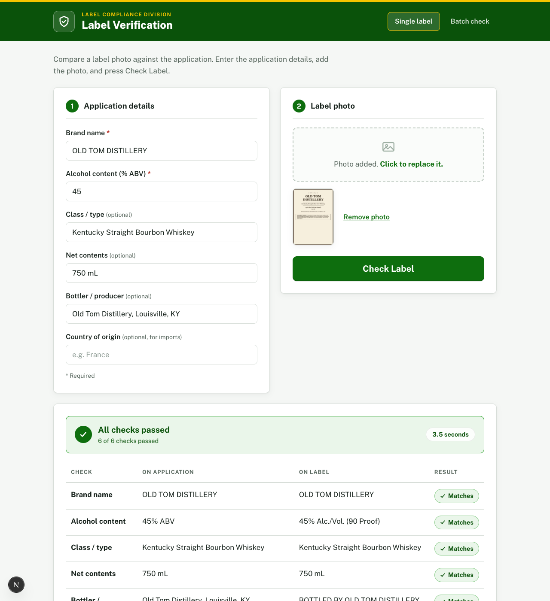
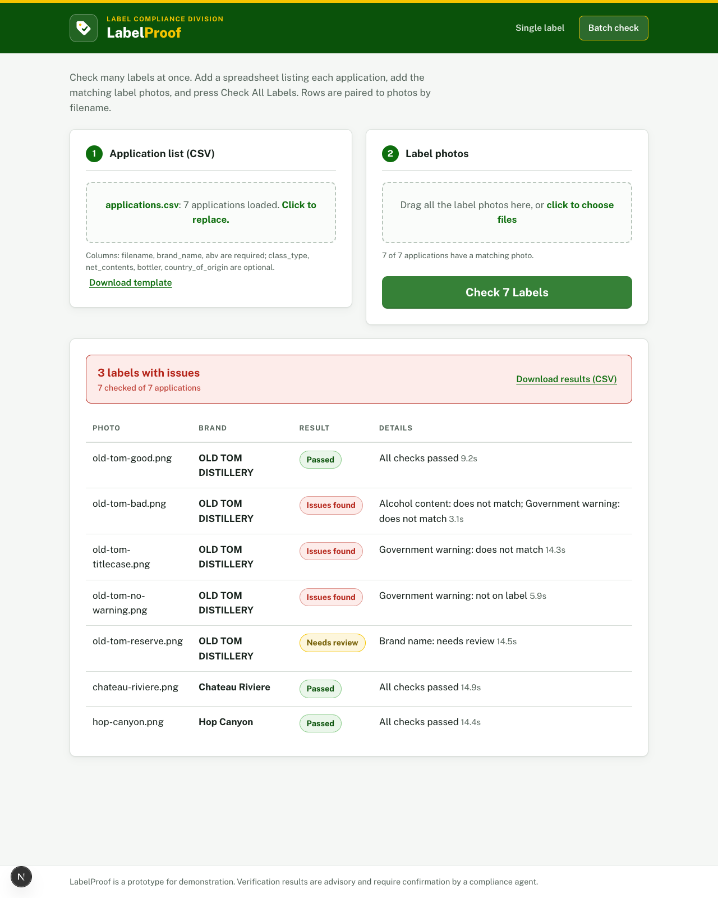

# LabelProof: AI-Powered Alcohol Label Verification

**Author: Dr. Ousmane Barry**

A prototype for TTB label-compliance agents. An agent enters what the COLA
application says, adds a photo of the label, and presses **Check Label**. The
app reads the label with Claude vision and reports, field by field, whether
the label matches the application, in about 3 seconds.



## Quick start

```bash
npm install
cp .env.example .env.local   # then paste your Anthropic API key
npm run dev                  # open http://localhost:3000
```

Requires Node 18+ and an [Anthropic API key](https://platform.claude.com/).
Try it immediately with the ready-made samples in `test-labels/`.

## What it does

**Single label** (the main flow): fill in the application details, add the
label photo, press Check Label. Results appear as a color-coded table showing
what the application says, what the label says, and a verdict for each field.

**Batch check** (for importer season): drop a CSV listing many applications
plus all the label photos in one go. Rows pair to photos by filename, four
labels are checked in parallel with a live progress bar, and the results
export back to CSV so agents work the exceptions instead of clicking through
one at a time.



### The checks

| Check | How it is compared |
|---|---|
| Brand name | Case, punctuation, apostrophe, and accent insensitive ("STONE'S THROW" matches "Stone's Throw"; "CHÂTEAU RIVIÈRE" matches "Chateau Riviere"). Near-matches and typo-level differences ("Wiskey" vs "Whiskey") go to human review, never silently passed or failed |
| Alcohol content | Numeric ABV comparison; handles printed formats like "45% Alc./Vol. (90 Proof)" |
| Class / type (optional) | Text comparison, same rules as brand name |
| Net contents (optional) | Unit insensitive ("750 mL" matches "750ML"; "12 fl oz" matches "12 FL OZ"). A matching quantity with a missing unit ("750" vs "750 mL") goes to review |
| Bottler / producer (optional) | Lenient: the printed statement may add "BOTTLED BY" or vary formatting; partial overlap goes to review |
| Country of origin (optional, imports) | Lenient ("France" matches "PRODUCT OF FRANCE") |
| Government warning | Word-for-word against the statement required by 27 CFR Part 16. Wrong wording, or a heading not printed as capital-letter GOVERNMENT WARNING, is a hard failure. A heading that does not appear bold goes to human review; if boldness cannot be judged from the photo, the agent is not bothered |

Every verdict is one of **Matches**, **Does not match**, **Not on label**, or
**Needs review**. The tool never silently decides borderline cases; it
escalates them to the agent with both values shown side by side.

## Approach, tools, and assumptions

### Approach

1. **Split reading from deciding.** The AI model only transcribes what is
   printed on the label (structured output, validated against a schema).
   Plain TypeScript performs every comparison and renders the verdict. This
   keeps decisions deterministic, auditable, and unit-testable, which
   matters for a government compliance tool.
2. **Design to the discovery notes.** Every feature traces to a stakeholder
   statement: the 5-second budget drove the model choice and image
   downscaling, "my mother could figure it out" drove the one-screen UI,
   importer season drove batch mode, and agent anecdotes became unit tests
   (STONE'S THROW, the rejected title-case warning).
3. **Escalate, never guess.** Borderline text goes to "Needs review",
   unreadable photos are flagged instead of interpreted, and the agent
   always makes the final call.
4. **Test at three levels.** Unit tests on the comparison rules, live API
   tests against real sample labels, and Puppeteer browser tests that drive
   the UI the way an agent would.

### Tools used

| Tool | Role |
|---|---|
| Next.js 15, React 19, TypeScript | Full-stack app framework; one API route, two pages, no database |
| Anthropic Claude API (`claude-haiku-4-5`) | Vision model that reads the label; chosen for speed to meet the 5-second requirement |
| Zod + structured outputs (`messages.parse`) | Guarantees the model returns machine-readable JSON matching a declared schema |
| Public Sans (via `next/font`) | U.S. federal design system typeface, bundled at build time so no runtime font CDN |
| Puppeteer + headless Chrome | Browser end-to-end tests, and rendering the sample label images in `test-labels/` |
| Plain CSS | No UI framework; keeps the prototype dependency-light |

### Assumptions made

- **Application data is entered manually or via CSV.** No COLA system
  integration in the prototype, per the IT discovery interview.
- **One label image per check.** Assumed the photo shows the fields being
  verified; multi-image (front and back label) support is listed as a next
  step.
- **Exact ABV match.** The label is checked against the application value,
  not against TTB's class-specific tolerance bands; tolerance rules could be
  added to the comparison layer without touching the AI.
- **Warning text per 27 CFR Part 16.** The statutory statement is compared
  word for word; capitalization of GOVERNMENT WARNING is enforced as a hard
  failure and bold print as a review item, matching how agents described
  adjudicating it.
- **English-language labels** and Latin-script brand names (accents are
  folded for comparison).
- **Shared-password access, not per-user accounts.** Scoped as a prototype
  on a trusted network; results are advisory and never stored. Access is
  gated by one shared password (see Security settings below).
- **Time verdicts are advisory.** The 5-second target is measured and
  displayed per check, assuming typical broadband; the first request after
  deploy is slower (model schema compilation).

## How discovery shaped the design

**"If we can't get results back in about 5 seconds, nobody's going to use it."**
(Sarah Chen, recalling the failed 30-second scanning-vendor pilot)

- Model: `claude-haiku-4-5`, Anthropic's fastest. Label reading is a simple
  transcription task where it is strong; measured round trips are 3.0 to 3.7
  seconds. Set `CLAUDE_MODEL=claude-opus-4-8` to trade speed for maximum
  accuracy.
- One API call per verification, no multi-step chains, and photos are
  downscaled in the browser (max 1568px) before upload so a 12MP phone photo
  costs nothing extra.
- Every result displays its own elapsed time, keeping the speed budget honest.

**"My mother could figure it out."** (Sarah Chen, on the range of tech comfort)

- One screen, two numbered steps, one big button. No settings, no jargon.
- Large base type, high-contrast colors, keyboard-accessible dropzones, and
  results announced to screen readers.
- Errors are plain language with a next step ("Could not read the label.
  Please retake the photo."), never technical.

**"Importers dump 200, 300 label applications on us at once... handle batch
uploads."** (Sarah Chen)

- The Batch check page, described above. A downloadable CSV template shows the
  expected columns, and header names are matched leniently ("Brand Name",
  "brand_name", and "brand" all work). Bad rows are reported by line number
  instead of failing the whole file.

**"You can't just pattern match everything... 'STONE'S THROW' on the label but
'Stone's Throw' in the application. You need judgment."** (Dave Morrison)

- That exact scenario is a passing unit test, along with apostrophe, period,
  and accent variations. Genuinely different brands still fail.
- Close-but-not-identical text goes to "Needs review" with both values shown.
  The judgment call stays with the agent.
- The tool is additive: results are advisory, nothing about the existing
  workflow changes, and a skeptical agent can ignore it entirely.

**"The warning statement check is actually trickier than it sounds. It has to
be exact... 'GOVERNMENT WARNING:' has to be in all caps and bold."**
(Jenny Park, who saw a title-case label rejected)

- A single changed word fails the check (verified live: "due to the risk"
  instead of "because of the risk" is caught).
- A title-case heading is a hard failure, matching how agents adjudicate it.
- Bold print is judged visually by the model. Correct wording in non-bold type
  goes to human review; when boldness cannot be determined the tool stays
  quiet rather than crying wolf.
- Bad angles, lighting, and glare (Jenny's "maybe out of scope" wish): the
  model is instructed never to guess at illegible text, and results carry an
  explicit photo-quality warning so the agent knows to request a better image.

**"It's just... matching. Essentially data entry verification."** (Sarah Chen)

- The AI does the tedious part (reading the label) but the decision stays
  deterministic and auditable: Claude only transcribes what is printed
  (structured output validated against a schema), and plain code performs
  every comparison. The same label and application always produce the same
  verdict.

## Architecture

```
Browser
  ├─ app/page.tsx        single label check
  ├─ app/batch/page.tsx  batch check: CSV + photos paired by filename,
  │                      4 concurrent requests, progress bar, CSV export
  └─ downscales photo, then POST /api/verify
Next.js API route (app/api/verify/route.ts)
  ├─ Claude (claude-haiku-4-5, vision + structured output)
  │    └─ transcribes label fields (never compares)
  └─ lib/verification.ts
       └─ deterministic comparison, per-field verdicts
```

- **Next.js 15 / React 19 / TypeScript.** No database; stateless by design,
  since pre-approval label artwork may be confidential.
- **Structured outputs** (`client.messages.parse` with a Zod schema) guarantee
  the model's answer is machine-readable. No brittle JSON parsing.
- The API key lives server-side only; the browser never talks to Anthropic
  directly.

## Deployment and IT notes

Written for the constraints raised in discovery (locked-down government
network, Azure hosting, no COLA integration for the prototype):

- **One outbound domain.** The server makes HTTPS (443) calls to
  `api.anthropic.com` and nothing else. Fonts are bundled at build time, and
  there are no analytics, CDNs, or telemetry. Allowlisting a single domain is
  the entire firewall change.
- **Fails fast and diagnosably when blocked.** API calls time out after 30
  seconds instead of the SDK's 10-minute default, and a blocked connection
  returns a message naming the exact domain to allowlist. A firewall problem
  is identified on the first attempt, not debugged for a week.
- **Nothing is stored.** No database, no disk writes. Label photos are
  processed in memory per request and discarded; results exist only in the
  agent's browser. All configuration is environment variables.
- **Standalone by design.** No COLA integration; application data is entered
  manually or via CSV, matching the prototype scoping.
- **Runs anywhere Node 18+ runs**, including Azure App Service:
  `npm run build && npm start` with `ANTHROPIC_API_KEY` and `APP_ACCESS_PASSWORD` in app settings.
- **Security settings.** Every `/api/verify` call spends Anthropic credits,
  so the API is protected (see `.env.example`):
  - `APP_ACCESS_PASSWORD` (required in production): HTTP Basic auth on all
    pages and the API; the browser prompts once. Optional `APP_ACCESS_USER`.
    With `NODE_ENV=production` and no password, `/api/verify` returns 503
    and logs a SECURITY error. Set `ALLOW_UNAUTHENTICATED=true` only when an
    upstream SSO (e.g. Azure App Service Authentication) already restricts
    access. Local `npm run dev` stays open when no password is set.
  - `RATE_LIMIT_PER_MINUTE` (default 60 per client IP) and
    `DAILY_REQUEST_CAP` (default 2000 Anthropic calls per UTC day); 0
    disables. Counters are in memory per server instance, so with N
    instances the effective limits are N times higher. The batch page
    retries automatically on a per-IP 429.
  - Client IP: never taken from the client-controlled left-most
    `X-Forwarded-For` entry. Auto-detected on Vercel (`x-vercel-forwarded-for`)
    and Azure App Service (1 proxy hop). Elsewhere set `TRUST_PROXY_HOPS` to
    the number of proxies in front of the app, or `CLIENT_IP_HEADER` to a
    header your proxy overwrites; otherwise all clients share one bucket.
- A production deployment would need review against federal retention and PII
  policies, including the Anthropic API's data retention terms; out of scope
  for this exercise per discovery.

## Testing

Three layers, all in the `tests/` folder and all currently passing. CI
(GitHub Actions) runs the type check, unit tests, and production build on
every push.

1. **Unit tests** on the deterministic comparison logic, the CSV parser,
   and the access/rate-limit helpers (`lib/security.ts`):

   ```bash
   npm test
   ```

   Covers matches, mismatches, missing/altered/title-case warnings, bold
   judgment, the STONE'S THROW scenario, accent folding, unit variations,
   lenient bottler/origin matching, image-quality flags, CSV parsing
   edge cases, Basic auth, client-IP selection, and rate/daily limits.
   No API key needed.

2. **Browser end-to-end tests** (Puppeteer + your installed Chrome), which
   drive the real UI and make real API calls. Start the dev server first:

   ```bash
   npm run dev            # in one terminal, with ANTHROPIC_API_KEY set
                          # (leave APP_ACCESS_PASSWORD unset for e2e)
   npm run test:e2e       # single-label flow: pass and fail cases
   npm run test:e2e:batch # all seven samples through batch mode
   ```

3. **Sample labels with known outcomes** (see below) double as live API
   regression tests.

`test-labels/` contains seven rendered sample labels with known expected
outcomes (3 pass, 3 fail, 1 needs review), covering spirits, imported wine
with accented characters, a beer can, a wrong ABV, altered/missing/title-case
government warnings, and a near-match brand. See `test-labels/README.md` for
the matrix; `applications.csv` in the same folder drives all seven through
the Batch page in one drop.

## Known limitations and next steps

- **Single label image per check.** Many COLAs have front and back labels,
  and the warning is often on the back. Next step: multi-image upload
  verified as one set.
- **No COLA system integration.** Agents re-enter application data today; the
  obvious v2 pulls it from COLAs Online by application ID.
- **Type size not verified.** Wording, capitalization, and bold print of the
  warning are checked, but minimum type-size rules (which depend on container
  size) cannot be measured reliably from an uncalibrated photo.
- **Batch runs in the browser tab.** Four labels at a time through the live
  API; a 300-label batch takes roughly 4 to 5 minutes with the tab open. A
  production version would queue server-side (Anthropic Batch API, half the
  cost) and notify the agent when done.
